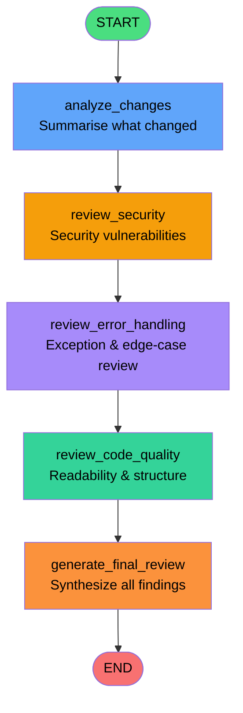

# AI Code Review Agent

> **A multi-step agentic code review system powered by Google Gemini and LangGraph.**
> Fetches a git diff from GitHub, passes it through a sequential AI review pipeline, and produces a structured report covering security, error handling, code quality, and a final synthesised recommendation.

---

## Table of Contents

- [Project Overview](#project-overview)
- [Key Features](#key-features)
- [How the System Works](#how-the-system-works)
- [Architecture Diagram](#architecture-diagram)
- [Technology Stack](#technology-stack)
- [Repository Structure](#repository-structure)
- [Prerequisites](#prerequisites)
- [Installation & Local Setup](#installation--local-setup)
- [Environment Variable Configuration](#environment-variable-configuration)
- [Configuration Variables](#configuration-variables)
- [Running the Workflow](#running-the-workflow)
- [Offline Tests](#offline-tests)
- [Error Handling, Timeouts & Retry Behaviour](#error-handling-timeouts--retry-behaviour)
- [Current Status & Limitations](#current-status--limitations)
- [Future Improvements](#future-improvements)
- [Security Considerations](#security-considerations)
- [Contributing](#contributing)
- [License](#license)
- [Author](#author)

---

## Project Overview

Manual code review is time-consuming, error-prone, and inconsistent. This project automates that process using a **LangGraph-orchestrated, multi-step AI pipeline** that:

1. Retrieves the latest commit diff from a GitHub repository via the GitHub API.
2. Runs the diff through four sequential, specialised Gemini AI review nodes.
3. Synthesises all findings into a single, executive-ready markdown review report.

Each review node has a distinct, scoped responsibility — change analysis, security review, error-handling review, and code quality review — before a final node consolidates everything into one coherent output.

---

## Key Features

| Feature | Detail |
|---|---|
| **Multi-step agentic pipeline** | Five-node LangGraph DAG; each node is a focused specialist |
| **Gemini AI integration** | Uses `google-genai` SDK with `generateContent` API |
| **GitHub diff fetching** | Retrieves commit patches via PyGithub |
| **Structured state passing** | `AgentState` TypedDict propagates intermediate results between nodes |
| **Hardened API calls** | 120-second HTTP timeouts on all production Gemini calls |
| **Smart retry logic** | Tenacity retries only on transient 5xx server errors and `httpx` transport failures; never retries 4xx or quota errors |
| **Layered error handling** | `APIError`, `RuntimeError`, and `ValueError` are caught and re-raised with clean messages |
| **Comprehensive offline tests** | Six standalone test scripts, all runnable without API credentials |

---

## How the System Works

The pipeline operates as a strictly linear, deterministic chain — no branching, no conditional edges.

1. **Input preparation** (`src/test_review_graph.py`): authenticates to GitHub, fetches the latest commit from the configured repository, and assembles the raw patch into a combined diff string plus a context label (`Commit <sha>: <message>`).

2. **`analyze_changes`**: Receives the raw diff and optional context. Asks Gemini to summarise what behavioural changes were introduced. Stores the result in `AgentState.change_analysis`.

3. **`review_security`**: Receives the diff plus the change analysis summary. Asks a security-specialist Gemini persona to identify credential exposure, unsafe API usage, input validation gaps, and similar risks. Stores the result in `AgentState.security_review`.

4. **`review_error_handling`**: Reviews exception handling, boundary validation, resource cleanup, and null-state scenarios. Stores the result in `AgentState.error_handling_review`.

5. **`review_code_quality`**: Reviews readability, modularity, naming clarity, duplication, and structural quality. Stores the result in `AgentState.quality_review`.

6. **`generate_final_review`**: Receives all four prior review sections and synthesises them into a single, clean markdown report organised as: *Summary of Changes → Security Analysis → Error Handling & Reliability → Code Quality & Maintainability → Final Recommendation*.

---

## Architecture Diagram



**State flow through the graph:**

```
AgentState {
  diff                  → raw git patch (input)
  context               → "Commit abc1234: fix login bug" (input)
  change_analysis       → set by analyze_changes
  security_review       → set by review_security
  error_handling_review → set by review_error_handling
  quality_review        → set by review_code_quality
  final_review          → set by generate_final_review (output)
}
```

---

## Technology Stack

| Technology | Version Constraint | Role in This Project |
|---|---|---|
| **Python** | ≥ 3.11 (uses `str \| None` union syntax) | Runtime language |
| **google-genai** | ≥ 1.0.0 | Official Google Gemini SDK; used for `generateContent` calls |
| **LangGraph** | ≥ 0.2.0 | Orchestrates the five-node review DAG as a compiled `StateGraph` |
| **PyGithub** | ≥ 2.1.0 | Authenticates to GitHub and fetches commit patch data |
| **Pydantic** | ≥ 2.0.0 | Dependency of LangGraph; used for state schema validation |
| **Tenacity** | ≥ 8.2.0 | Retry decorator on Gemini calls (up to 3 attempts, exponential backoff) |
| **httpx** | Transitive (via google-genai) | Transport layer; specific exception types (`TimeoutException`, `ConnectError`) are inspected by the retry predicate |
| **python-dotenv** | ≥ 1.0.0 | Loads `.env` file into environment at startup |

> **ChromaDB, MongoDB, FastAPI, Semgrep, Tree-sitter, and RAG retrieval** are not part of the current implementation. See [Current Status & Limitations](#current-status--limitations).

---

## Repository Structure

```
ai-code-review-agent/
│
├── src/
│   ├── __init__.py
│   ├── agent_state.py          # AgentState TypedDict (shared graph state)
│   ├── config.py               # Loads .env; exposes Config class with validate()
│   ├── gemini_client.py        # get_gemini_client() + generate_test_response()
│   ├── github_client.py        # GitHub auth + commit diff fetching via PyGithub
│   ├── review_graph.py         # create_review_graph() — builds & compiles the LangGraph DAG
│   ├── review_nodes.py         # Five node functions + _call_gemini() with retry logic
│   ├── code_reviewer.py        # Standalone review_code_diff() helper (single-call reviewer)
│   ├── check_env.py            # Phase 1: environment & package verification script
│   ├── test_gemini.py          # Phase 2: live Gemini API connectivity test
│   ├── test_github.py          # Phase 4: live GitHub commit diff extraction test
│   └── test_review_graph.py    # Phase 6: end-to-end multi-step workflow demo
│
├── test_graph_topology.py      # Offline: verifies LangGraph DAG structure (no API calls)
├── test_gemini_client_offline.py  # Offline: unit tests for gemini_client.py
├── test_retry_predicate.py        # Offline: unit tests for _is_transient_error()
├── test_production_gemini_timeouts.py  # Offline: verifies 120 s timeouts are wired
├── test_review_node_behaviour.py  # Offline: unit tests for all five node functions
├── test_code_reviewer_edge_cases.py  # Offline: unit tests for code_reviewer.py
│
├── build_report_pdf.py         # Standalone PDF report builder (uses fpdf2; not part of workflow)
├── requirements.txt            # Runtime + test dependencies
├── .env.example                # Template for required environment variables
├── .gitignore                  # Excludes .env, .venv, __pycache__, *.pdf
└── README.md                   # This file
```

---

## Prerequisites

- **Python 3.11 or later** (the code uses `str | None` union syntax which requires Python 3.10+; 3.11+ is recommended)
- **pip** (bundled with Python)
- **A Google Gemini API key** — obtain one from [Google AI Studio](https://aistudio.google.com/app/apikey)
- **A GitHub Personal Access Token (PAT)** — needed for authenticated GitHub API requests; a fine-grained token with read-only access to repository contents is sufficient
- **Git** — to clone the repository

> **Note on Gemini model availability:** The default model is `gemini-3.8-flash`. Model availability varies by account tier. If you receive an HTTP 404 error, run `python -c "from src.gemini_client import get_gemini_client; [print(m.name) for m in get_gemini_client().models.list()]"` to list models available for your key, then set `GEMINI_MODEL` accordingly in your `.env`.

---

## Installation & Local Setup

All commands are written for **Windows PowerShell**. Adjust path separators for other shells.

### 1. Clone the repository

```powershell
git clone https://github.com/Niteshkumar-codes/ai-code-review-agent.git
cd ai-code-review-agent
```

### 2. Create and activate a Python virtual environment

```powershell
python -m venv .venv
.venv\Scripts\Activate.ps1
```

If your PowerShell execution policy blocks script activation, run:

```powershell
Set-ExecutionPolicy -ExecutionPolicy RemoteSigned -Scope CurrentUser
```

### 3. Install dependencies

```powershell
pip install -r requirements.txt
```

### 4. Verify the environment

```powershell
.venv\Scripts\python.exe src\check_env.py
```

Expected output (Phase 1):

```
==================================================
 PHASE 1: ENVIRONMENT & CONFIGURATION CHECK
==================================================
Python Executable: ...\.venv\Scripts\python.exe
Python Version   : 3.11.x

--- 1. Package Installation Verification ---
  [OK] python-dotenv    Version: x.x.x
  [OK] google-genai     Version: x.x.x
  [OK] PyGithub         Version: x.x.x
  [OK] pydantic         Version: x.x.x
  [OK] tenacity         Version: x.x.x

--- 2. Environment Variables Verification ---
  [OK] GEMINI_API_KEY   -> CONFIGURED
  [OK] GITHUB_TOKEN     -> CONFIGURED
  [WARN] MONGODB_URI    -> NOT SET
...
[SUCCESS] Environment Verification Passed!
```

`MONGODB_URI` is loaded by `Config` but is not used by the current workflow — the `[WARN]` is expected.

---

## Environment Variable Configuration

Copy `.env.example` to `.env` and fill in your credentials:

```powershell
Copy-Item .env.example .env
```

Open `.env` in a text editor and set the following values:

```dotenv
# Required — your Google Gemini API key from https://aistudio.google.com
GEMINI_API_KEY=your_gemini_api_key_here

# Required — GitHub Personal Access Token with repo read access
GITHUB_TOKEN=your_github_pat_here

# Optional — override the Gemini model used for all review calls
# Default: gemini-3.8-flash (confirmed available; availability varies by account tier)
# Leave blank to use the default.
GEMINI_MODEL=

# Not used by the current workflow — can be left blank
MONGODB_URI=
```

> ⚠️ **Never commit your `.env` file.** It is already listed in `.gitignore`.

---

## Configuration Variables

The `Config` class in `src/config.py` loads all values from `.env` at import time.

| Variable | Default | Required | Description |
|---|---|---|---|
| `GEMINI_API_KEY` | *(empty)* | **Yes** | Google Gemini API key |
| `GITHUB_TOKEN` | *(empty)* | **Yes** | GitHub PAT for commit fetching |
| `GEMINI_MODEL` | `gemini-3.8-flash` | No | Gemini model name; override if your key lacks access to the default |
| `MONGODB_URI` | *(empty)* | No | Present in config but **not used** by the current workflow |

`Config.validate()` returns a `dict[str, bool]` indicating which keys are set:
```python
{"GEMINI_API_KEY": True, "GITHUB_TOKEN": True, "MONGODB_URI": False}
```

---

## Running the Workflow

The current executable workflow is the **integration demo script** `src/test_review_graph.py`. It is the entry point for the full end-to-end pipeline:

```powershell
.venv\Scripts\python.exe src\test_review_graph.py
```

This script:

1. Validates that `GEMINI_API_KEY` and `GITHUB_TOKEN` are set.
2. Authenticates to GitHub and fetches the **latest commit** from `Niteshkumar-codes/ai-code-review-agent`.
3. Assembles all file patches from that commit into a combined diff.
4. Creates the LangGraph review graph.
5. Invokes the five-node pipeline on the diff.
6. Prints all five review sections to the terminal.

**Example illustrative output** *(not from a captured run — actual output depends on the current HEAD commit of the repository):*

```
==================================================
 PHASE 6: MULTI-STEP AGENTIC CODE REVIEW TEST
==================================================
[OK] GEMINI_API_KEY detected
[OK] GITHUB_TOKEN detected
[OK] GitHub authentication successful
[OK] Commit diff retrieved
[OK] Review input prepared
[OK] LangGraph workflow created
[OK] Workflow execution started

--------------------------------------------------
CHANGE ANALYSIS
--------------------------------------------------
The diff modifies `src/review_nodes.py`. The primary change tightens the
retry predicate `_is_transient_error` to only retry on known transient
`httpx` exceptions (`TimeoutException`, `ConnectError`) rather than all
non-APIError causes...

--------------------------------------------------
SECURITY REVIEW
--------------------------------------------------
No security vulnerabilities identified in this diff. The change is
confined to retry logic; no credentials, user input, or permissions
are affected...

--------------------------------------------------
ERROR HANDLING REVIEW
--------------------------------------------------
The updated predicate correctly narrows the retry scope. Previously,
a plain `RuntimeError` with no `__cause__` would have fallen through
to an unconstrained retry path...

--------------------------------------------------
CODE QUALITY REVIEW
--------------------------------------------------
The refactoring is well-structured. The `_TRANSIENT_HTTPX_EXCEPTIONS`
tuple is a clean, extensible constant. The predicate function is
self-documenting...

--------------------------------------------------
FINAL REVIEW
--------------------------------------------------
## Summary of Changes
...

## Final Recommendation
**Approve.** The change is safe, focused, and well-tested...

--------------------------------------------------
[SUCCESS] Multi-Step Agentic Code Review Verified!
==================================================
```

> **Note:** The script is hardcoded to review `Niteshkumar-codes/ai-code-review-agent` and always fetches the latest (HEAD) commit. To review a different repository or a specific commit SHA, edit lines 34–37 of `src/test_review_graph.py` before running.

### Individual connectivity tests

You can also run the integration tests in isolation to verify each component:

```powershell
# Phase 1 — environment check (no API calls)
.venv\Scripts\python.exe src\check_env.py

# Phase 2 — live Gemini API test (requires GEMINI_API_KEY)
.venv\Scripts\python.exe src\test_gemini.py

# Phase 4 — GitHub commit diff extraction (requires GITHUB_TOKEN)
.venv\Scripts\python.exe src\test_github.py

# Phase 6 — full end-to-end pipeline (requires both keys)
.venv\Scripts\python.exe src\test_review_graph.py
```

---

## Offline Tests

Six standalone offline test scripts exercise the codebase without making any real API calls. All use `unittest.mock` and sentinel environment variables. **No API credentials are needed.**

| Script | What it covers |
|---|---|
| `test_graph_topology.py` | Verifies the LangGraph DAG has exactly 5 nodes, 6 edges, no conditional edges, correct entry/exit points, and the right `AgentState` keys |
| `test_gemini_client_offline.py` | Tests `get_gemini_client()` key validation, timeout constant, `AutomaticFunctionCallingConfig`, response text passthrough, and `Config.validate()` |
| `test_retry_predicate.py` | Tests `_is_transient_error()` against real SDK exception instances for all relevant HTTP status codes (400, 401, 403, 404, 429, 500, 502, 503, 504) and httpx exceptions |
| `test_production_gemini_timeouts.py` | Regression tests that both `_call_gemini()` and `review_code_diff()` wire `HttpOptions(timeout=120_000)` into every Gemini request |
| `test_review_node_behaviour.py` | Tests all five node functions: return-key contract, single `_call_gemini` invocation, RuntimeError propagation, prompt assembly |
| `test_code_reviewer_edge_cases.py` | Tests `review_code_diff()` context handling, `APIError` wrapping, generic exception wrapping, and empty response guard |

### Running all offline tests

```powershell
.venv\Scripts\python.exe test_graph_topology.py
.venv\Scripts\python.exe test_gemini_client_offline.py
.venv\Scripts\python.exe test_retry_predicate.py
.venv\Scripts\python.exe test_production_gemini_timeouts.py
.venv\Scripts\python.exe test_review_node_behaviour.py
.venv\Scripts\python.exe test_code_reviewer_edge_cases.py
```

All scripts exit with code `0` on success and `1` on failure, printing a clear `[OK]`/`[FAIL]` report per assertion.

---

## Error Handling, Timeouts & Retry Behaviour

### HTTP Timeouts

All production Gemini calls are protected by hard timeouts expressed in milliseconds (the unit expected by the `google-genai` SDK's `HttpOptions`):

| Call site | Constant | Timeout |
|---|---|---|
| `src/gemini_client.py` — `generate_test_response()` | `_TEST_TIMEOUT_MS` | **30 seconds** |
| `src/review_nodes.py` — `_call_gemini()` | `_REVIEW_NODE_TIMEOUT_MS` | **120 seconds** |
| `src/code_reviewer.py` — `review_code_diff()` | `_CODE_REVIEW_TIMEOUT_MS` | **120 seconds** |

### Retry Policy

The `_call_gemini()` function in `src/review_nodes.py` uses a Tenacity retry decorator:

- **Maximum attempts:** 3
- **Backoff:** exponential, 2 s minimum, 30 s maximum
- **Retry predicate:** `_is_transient_error()` — only retries on:
  - `APIError` with HTTP status `500`, `502`, `503`, or `504` (transient server-side failures)
  - `httpx.TimeoutException` (and its subclasses: `ReadTimeout`, `WriteTimeout`, `ConnectTimeout`, `PoolTimeout`)
  - `httpx.ConnectError` (TCP refused, DNS failure)

- **Never retried:**
  - HTTP `400` (Bad Request), `401` (Unauthenticated), `403` (Forbidden), `404` (model not found)
  - HTTP `429` (quota/rate-limit) — requires a configuration or account fix, not retrying
  - `ValueError`, `TypeError`, or any other non-`APIError` cause — indicates a programming error
  - `httpx.InvalidURL` or other non-transport httpx errors

### Error Propagation

All Gemini API errors are caught, wrapped as `RuntimeError` (preserving the original exception as `__cause__`), and re-raised with a descriptive message. Callers are expected to handle `RuntimeError` for workflow failures.

---

## Current Status & Limitations

The following capabilities are **implemented and working** in the current codebase:

- [x] Multi-step LangGraph review pipeline (5 nodes, linear DAG)
- [x] GitHub commit diff fetching via PyGithub
- [x] Gemini AI review via `google-genai` SDK
- [x] Hardened API calls (timeouts, retry, error wrapping)
- [x] Structured state passing via `AgentState` TypedDict
- [x] Six offline test suites for unit and regression coverage

The following are **not implemented** in the current codebase and should not be assumed to be present:

- ❌ **FastAPI service or REST API** — no HTTP server; the workflow is invoked as a Python script
- ❌ **Web frontend or UI** — no browser interface
- ❌ **MongoDB persistence** — `MONGODB_URI` is in the config but not used by any workflow code
- ❌ **RAG retrieval** — no vector database or embedding retrieval integrated into the review pipeline
- ❌ **ChromaDB** — not installed or referenced in the current code
- ❌ **Semgrep integration** — no static analysis tooling wired into the pipeline
- ❌ **Tree-sitter integration** — not implemented
- ❌ **Automatic GitHub webhook processing** — no event listener or webhook handler
- ❌ **Production deployment** — no Docker, cloud deployment, or CI/CD pipeline
- ❌ **PDF report generation within the workflow** — `build_report_pdf.py` is a standalone script unconnected to the review graph
- ❌ **Configurable target repository via CLI** — the repository and owner are currently hardcoded in the demo scripts

---

## Future Improvements

Planned enhancements (not yet implemented):

- **REST API wrapper** — expose the review pipeline via a FastAPI endpoint so it can be called programmatically
- **CLI with arguments** — accept `--repo`, `--owner`, `--sha` arguments to review arbitrary repositories and commits
- **GitHub webhook integration** — trigger reviews automatically on `push` or `pull_request` events
- **MongoDB persistence** — store review results for history and diffing over time
- **RAG context augmentation** — retrieve relevant codebase context from a vector store to give each node richer grounding
- **Parallel review nodes** — run security, error-handling, and quality reviews concurrently to reduce latency
- **Configurable review scope** — allow users to select which review dimensions to run
- **Structured output format** — return Pydantic-validated JSON instead of raw markdown strings
- **GitHub PR comment integration** — post the final review directly as a PR comment via the GitHub API
- **Docker packaging** — containerise the workflow for reproducible execution

---

## Security Considerations

- **API keys are never committed.** `.env` is in `.gitignore`. Only `.env.example` (with empty values) is tracked.
- **The diff is treated as untrusted input.** Each node's system instruction explicitly directs Gemini not to invent files, behaviors, or vulnerabilities that are not visible in the supplied diff.
- **No credentials are printed.** All test scripts use offline sentinel values and contain explicit comments confirming that no real keys are logged.
- **GitHub token scope:** A fine-grained PAT with read-only access to repository contents and metadata is sufficient. No write permissions are required.
- **Model availability note:** The configured model (`gemini-3.8-flash`) was confirmed available for the author's API key. Availability varies by account tier. A 404 error on model lookup is a configuration issue, not a transient error, and the retry logic is intentionally designed not to retry it.

---

## Contributing

Contributions, bug reports, and feature suggestions are welcome.

1. Fork the repository.
2. Create a feature branch: `git checkout -b feat/your-feature-name`
3. Make your changes and ensure all offline tests pass:
   ```powershell
   .venv\Scripts\python.exe test_graph_topology.py
   .venv\Scripts\python.exe test_gemini_client_offline.py
   .venv\Scripts\python.exe test_retry_predicate.py
   .venv\Scripts\python.exe test_production_gemini_timeouts.py
   .venv\Scripts\python.exe test_review_node_behaviour.py
   .venv\Scripts\python.exe test_code_reviewer_edge_cases.py
   ```
4. Commit with a descriptive message following the existing commit style (`feat:`, `fix:`, `test:`, `chore:`).
5. Open a pull request with a clear description of what was changed and why.

Please do not include your `.env` file, real API keys, or any generated PDFs in your pull request.

---

## License

No license has been specified for this repository yet. All rights are reserved by the author until a license is added.

---

## Author

**Nitesh Kumar**

- GitHub: [@Niteshkumar-codes](https://github.com/Niteshkumar-codes)
- LinkedIn: [nitesh-kumar-dev](https://linkedin.com/in/nitesh-kumar-dev)
